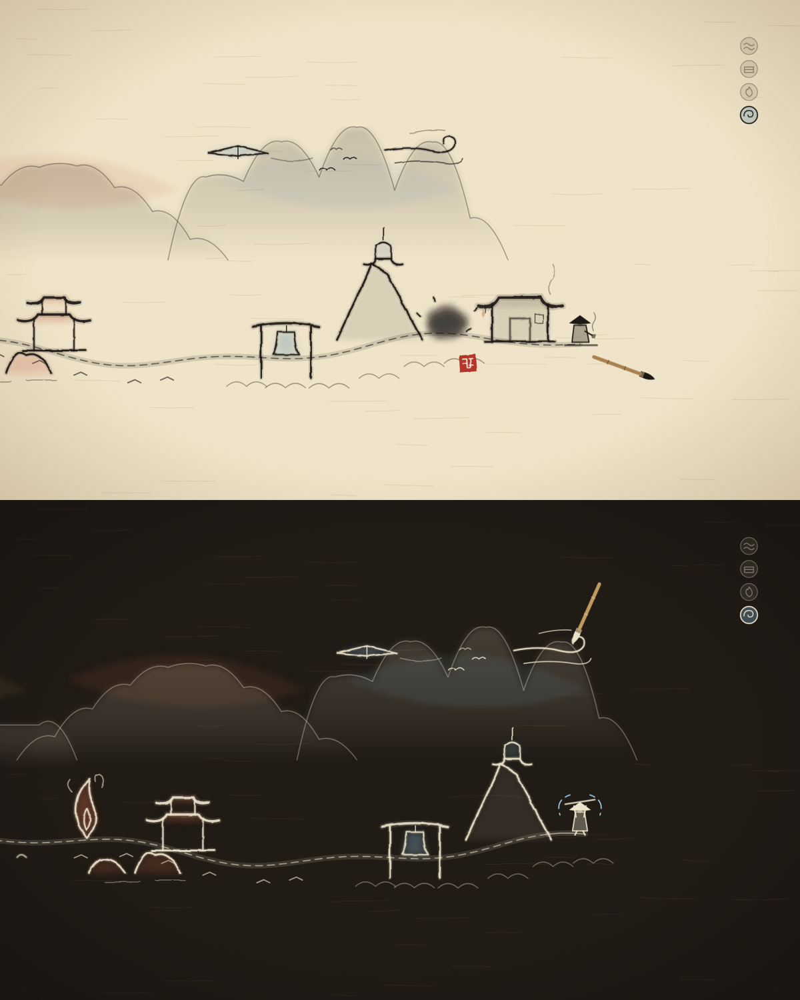

# Ink and Elements

An ink-wash theme for the Claude Code desktop app. Behind your conversation lies a long sheet of parchment, and while Claude works a brush paints a journey across it, one stroke at a time.



## How the painting follows Claude

- **Every tool call is a brushstroke.** The brush appears and draws a new piece of the scene stroke by stroke. The ink goes down dark and wet, then settles into soft grey. The camera pans along the scroll, and a traveler in a wide straw hat walks the trail to the newest painting.
- **The kind of work picks the element**, and each element has its own region of the world:

  | Element | Claude is… | The brush paints |
  | --- | --- | --- |
  | 💧 Water | reading and searching | an icy river valley: waves, ice floes, snowy pines, a fishing boat, a waterfall |
  | 🪨 Earth | editing and writing files | a great walled city: walls, stone pillars, a pagoda, boulders, a city gate |
  | 🔥 Fire | running commands | volcanic islands: a smoking volcano, flame spirals, a shrine, lanterns |
  | 🌬️ Air | working on the web or with agents | mountain-top temples: a temple spire, wind curls, clouds, a glider, a bell |

  The traveler takes a bending stance for each one: a ribbon of water, a floating stone, a curl of flame or a spinning staff. The four element glyphs in the corner show which one is active.
- **The scroll keeps growing.** Nothing is wiped between tasks. The trail winds on through every region Claude visits, so a long session leaves one long painting behind it.
- **When Claude asks you something**, the brush lifts, and the traveler stops on the trail with an unrolled map and looks back at you.
- **When a step fails**, the brush slips and a blot of ink spreads on the paper. It stays there, like a real mistake on a real scroll.
- **When Claude is done**, the brush paints a small tea shop at the end of the trail, its lantern starts to glow, and a red seal stamps the painting finished. The traveler sits down with a cup of tea.

It works in light and dark mode. By day the ink is black on warm parchment. By night the paper is lamp-lit umber and the ink is pale, like silver ink on dark paper. Messages are parchment slips, set in a serif, and headings are in seal red.

## Extras

- `/proverb` gives you a piece of original tea-shop wisdom, and tells you how many scenes of each element the brush has painted so far.
- Press the speaker icon in the session's title bar for sound: wind over paper with a sparse plucked string, a brush swish on each tool call, a soft temple bell when the painting is sealed, and a low thud when ink spills.

## Install

At the prompt of a Claude Code terminal session:

```text
/plugin install ink-and-elements --marketplace dmolloy98-stack-stack/claude_themes
```

Answer `y` to add the marketplace, then press Enter to install for your user. It loads in every new session on that computer, the desktop app included.

From a shell:

```bash
claude plugin install ink-and-elements --marketplace dmolloy98-stack-stack/claude_themes
```

In the desktop app: click **+** next to the prompt box, then **Plugins**, **Add marketplace** with `dmolloy98-stack-stack/claude_themes`, then **Add plugin**.

Start a new session afterwards and the parchment appears behind the conversation.

## A note on inspiration

This is a just-for-fun fan project. It takes its mood from classical East Asian ink-wash landscape painting, the four classical elements, and the feeling of a long journey in the animated adventure stories its author loves. Everything here is drawn from scratch: the traveler, the element glyphs, the seal and every scene are original vector art. No characters, names, symbols, logos or artwork from any show are used, and it isn't affiliated with or endorsed by any studio.
